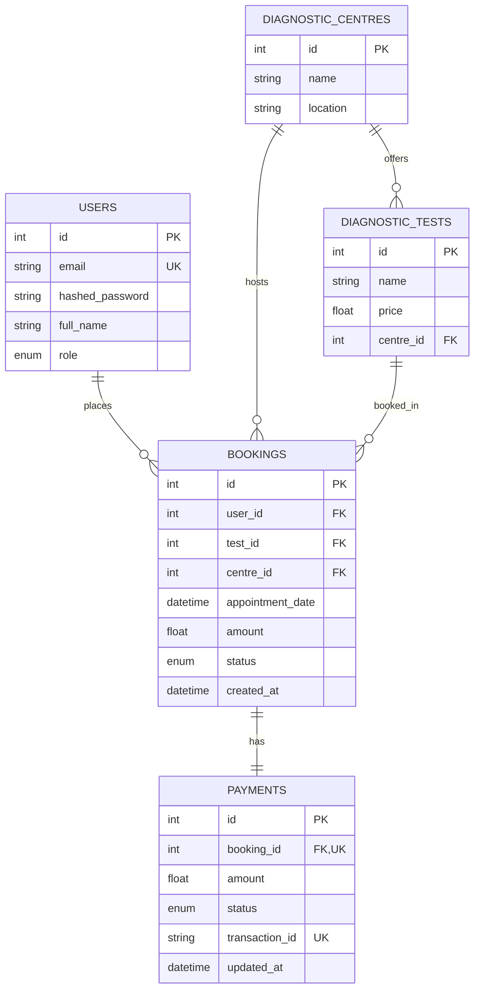
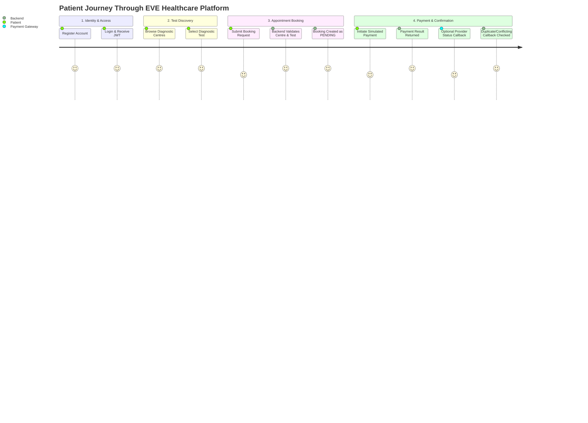

# 🏥 EVE Healthcare API — Comprehensive Project Report & Interview Guide

> **Project Name:** EVE Healthcare Diagnostic Test Booking & Payment Backend  
> **Tech Stack:** FastAPI, Python 3.11+, SQLAlchemy 2.0 (Async), PostgreSQL / SQLite, Pydantic v2, Docker & Docker Compose, Pytest  
> **Author:** Healthcare Platform Engineering Team  
> **Documentation Target:** System Architecture, Codebase Walkthrough, Pathway Reference & Interview Defense

---

## 📌 Table of Contents
1. [Executive Summary](#1-executive-summary)
2. [End-to-End System Pathways (API Endpoints)](#2-end-to-end-system-pathways-api-endpoints)
   - [Authentication Pathways (`/api/auth`)](#authentication-pathways-apiauth)
   - [Diagnostic Centres Pathways (`/api/centres`)](#diagnostic-centres-pathways-apicentres)
   - [Bookings Pathways (`/api/bookings`)](#bookings-pathways-apibookings)
   - [Payments & Webhook Pathways (`/api/payments`)](#payments--webhook-pathways-apipayments)
   - [System & Documentation Pathways](#system--documentation-pathways)
3. [Architecture & What We Implemented in Code](#3-architecture--what-we-implemented-in-code)
   - [Asynchronous Architecture](#asynchronous-architecture)
   - [Security & Authentication (JWT + Bcrypt)](#security--authentication-jwt--bcrypt)
   - [Role-Based Access Control (RBAC)](#role-based-access-control-rbac)
   - [Relational Data Modeling](#relational-data-modeling)
   - [Payment Processing & Webhook Idempotency Flow](#payment-processing--webhook-idempotency-flow)
   - [Defensive Validation & Edge Case Handling](#defensive-validation--edge-case-handling)
4. [File-by-File Codebase Deep Dive](#4-file-by-file-codebase-deep-dive)
   - [`main.py`](#mainpy)
   - [`app/database.py`](#appdatabasepy)
   - [`app/models.py`](#appmodelspy)
   - [`app/schemas.py`](#appschemaspy)
   - [`app/auth.py`](#appauthpy)
   - [`app/crud.py`](#appcrudpy)
   - [`app/routers/auth.py`](#approutersauthpy)
   - [`app/routers/centres.py`](#approuterscentrespy)
   - [`app/routers/bookings.py`](#approutersbookingspy)
   - [`app/routers/payments.py`](#approuterspaymentspy)
   - [`tests/test_api.py`](#teststest_apipy)
   - [`Dockerfile` & `docker-compose.yml`](#dockerfile--docker-composeyml)
   - [`pytest.ini` & `requirements.txt`](#pytestini--requirementstxt)
5. [Complete User Journey & Data Lifecycle](#5-complete-user-journey--data-lifecycle)
6. [Top Interview Questions & Ideal Technical Answers](#6-top-interview-questions--ideal-technical-answers)
7. [Production Hardening & Future Scaling](#7-production-hardening--future-scaling)

---

## 1. Executive Summary

The **EVE Healthcare API** is an assignment-scale asynchronous backend service for diagnostic test discovery, medical appointment scheduling, and simulated payment processing. It demonstrates core API and data-modeling patterns; it is not production-hardened.

### Key Capabilities Built:
- **Stateless Authentication**: JWT bearer tokens signed using HMAC-SHA256 with password hashing via Bcrypt.
- **Role-Based Access Control (RBAC)**: Segregated permissions for standard patients (`USER`) and healthcare administrators (`ADMIN`).
- **Relational Domain Engine**: Asynchronous SQLAlchemy 2.0 ORM with PostgreSQL (production/docker) and SQLite fallback (local/dev/testing).
- **Simulated Payment Lifecycle**: Payment initiation returns a simulated final result; a webhook accepts provider status notifications.
- **Webhook Idempotency**: Identical final-status retries do not repeat state changes, conflicting final statuses are rejected, and PostgreSQL row locking serializes concurrent updates.
- **Containerized Infrastructure**: Zero-config container orchestration with Docker and Docker Compose.

---

## 2. End-to-End System Pathways (API Endpoints)

All application routes are prefixed under `/api` and grouped into domain-specific routers.

```
                    ┌────────────────────────┐
                    │     Client / Frontend   │
                    └───────────┬────────────┘
                                │
                                ▼
                    ┌────────────────────────┐
                    │     FastAPI Router     │
                    └───────────┬────────────┘
         ┌───────────────┬──────┴────────┬───────────────┐
         ▼               ▼               ▼               ▼
   /api/auth        /api/centres    /api/bookings   /api/payments
   - signup         - create centre - create booking- initiate pay
   - login          - list centres  - list bookings - webhook
                    - get centre    - get booking
                    - create test
```

### Authentication Pathways (`/api/auth`)
| Method | Endpoint | Access Level | Request Body | Status Code | Description |
| :--- | :--- | :--- | :--- | :--- | :--- |
| `POST` | `/api/auth/signup` | Public | `UserCreate` (email, password, full_name) | `201 Created` | Registers a new user with hashed password; returns user profile without password. |
| `POST` | `/api/auth/login` | Public | `OAuth2PasswordRequestForm` (username/email, password) | `200 OK` | Verifies credentials; issues signed JWT Bearer access token. |

### Diagnostic Centres Pathways (`/api/centres`)
| Method | Endpoint | Access Level | Request Body | Status Code | Description |
| :--- | :--- | :--- | :--- | :--- | :--- |
| `POST` | `/api/centres/` | **Admin Only** | `DiagnosticCentreCreate` (name, location) | `201 Created` | Adds a diagnostic centre facility to the network. |
| `GET` | `/api/centres/` | Public / User | Query: `skip`, `limit` | `200 OK` | Lists all centres with their associated diagnostic tests (eager loaded). |
| `GET` | `/api/centres/{centre_id}` | Public / User | Path param: `centre_id` | `200 OK` | Retrieves detailed information of a single centre, including available tests. |
| `POST` | `/api/centres/{centre_id}/tests` | **Admin Only** | `DiagnosticTestCreate` (name, price) | `201 Created` | Registers a diagnostic test under the specified centre. |

### Bookings Pathways (`/api/bookings`)
| Method | Endpoint | Access Level | Request Body | Status Code | Description |
| :--- | :--- | :--- | :--- | :--- | :--- |
| `POST` | `/api/bookings/` | Authenticated User | `BookingCreate` (test_id, centre_id, appointment_date) | `201 Created` | Validates test-centre pairing; locks price and creates `PENDING` booking. |
| `GET` | `/api/bookings/` | Authenticated User | Query: `skip`, `limit` | `200 OK` | Retrieves all bookings belonging exclusively to the current logged-in user. |
| `GET` | `/api/bookings/{booking_id}` | Owner or Admin | Path param: `booking_id` | `200 OK` | Returns booking details. Non-owners receive `403 Forbidden`. |

### Payments & Webhook Pathways (`/api/payments`)
| Method | Endpoint | Access Level | Request Body | Status Code | Description |
| :--- | :--- | :--- | :--- | :--- | :--- |
| `POST` | `/api/payments/` | Authenticated User | `PaymentRequest` (booking_id, card_number, cvv) | `200 OK` | Simulates payment execution; records payment intent; returns transaction status. |
| `POST` | `/api/payments/webhook/` | Payment Gateway (Public/System) | `WebhookPayload` (transaction_id, booking_id, status) | `200 OK` | **Idempotent** webhook callback. Updates payment & booking status (`CONFIRMED`/`FAILED`). |

### System & Documentation Pathways
| Method | Endpoint | Access Level | Description |
| :--- | :--- | :--- | :--- |
| `GET` | `/` | Public | System status ping / welcome message. |
| `GET` | `/docs` | Public | Interactive Swagger UI OpenAPI documentation. |
| `GET` | `/redoc` | Public | Alternative ReDoc OpenAPI documentation. |

---

## 3. Architecture & What We Implemented in Code

### Asynchronous Architecture
- **Non-blocking Event Loop**: Powered by `asyncio` and `uvicorn`, handling hundreds of concurrent I/O operations per worker process.
- **SQLAlchemy 2.0 Async Extension**: Employs `AsyncSession` and `create_async_engine` with drivers `asyncpg` (PostgreSQL) and `aiosqlite` (SQLite), ensuring database calls do not block the worker thread.

### Security & Authentication (JWT + Bcrypt)
- Passwords are never stored in plaintext. They are salted and hashed using `passlib[bcrypt]`.
- Authentication uses the OAuth2 Password flow (`/api/auth/login`), generating signed JSON Web Tokens (`python-jose`).
- Every protected route utilizes FastAPI's `Depends(get_current_user)` dependency injection to decode the JWT, extract the user's identity, verify expiry (`exp`), and fetch the database record.

### Role-Based Access Control (RBAC)
- User models define roles via Python's `enum.Enum`:
  ```python
  class Role(str, enum.Enum):
      USER = "user"
      ADMIN = "admin"
  ```
- Endpoints modifying diagnostic inventory (`POST /api/centres/`, `POST /api/centres/{id}/tests`) explicitly inspect `current_user.role`. If not `ADMIN`, they return `403 Forbidden`.

### Relational Data Modeling
The database schema enforces data integrity through foreign key constraints and relational mappings:
1. `User` (1) ─── (N) `Booking`
2. `DiagnosticCentre` (1) ─── (N) `DiagnosticTest`
3. `DiagnosticCentre` (1) ─── (N) `Booking`
4. `DiagnosticTest` (1) ─── (N) `Booking`
5. `Booking` (1) ─── (1) `Payment`



### Payment Processing & Webhook Idempotency Flow
The mock payment endpoint immediately simulates a final result and updates the booking. The webhook models provider status notifications and protects state from duplicate and conflicting updates; this is not a real two-phase gateway integration.

1. **Step 1: Initiation (`POST /api/payments/`)**
   - User submits booking ID and simulated payment card.
  - Guard condition: User must own the booking, and the booking must not already be `CONFIRMED` or `CANCELLED`.
  - Card validation: A 12-19 digit number is required. Card `"0000000000000000"` simulates a decline; any other syntactically valid number simulates approval.
  - A unique transaction token (`txn_<uuid4>`) and final payment result are saved atomically with the booking transition to `FAILED` or `CONFIRMED`.

2. **Step 2: Webhook Reconciliation (`POST /api/payments/webhook/`)**
   - Simulated gateway fires status notifications to the webhook.
   - **Idempotency and validation**:
     - Looks up and locks the payment by `transaction_id`, then verifies the supplied booking ID matches the payment.
     - `PENDING` is not accepted as a webhook result. Repeating the already-applied final status returns `200 OK` with `{"message": "Already processed"}`.
     - A different final status for an already-final payment returns `409 Conflict` without changing either record.
     - The webhook is unauthenticated in this exercise; a real provider integration must verify signatures and event IDs.
   - **State Transition**:
     - `PaymentStatus.SUCCESS` -> `BookingStatus.CONFIRMED`
     - `PaymentStatus.FAILED` -> `BookingStatus.FAILED`

```mermaid
sequenceDiagram
    autonumber
    actor Client as Patient (User)
    participant API as FastAPI Backend
    participant DB as Database (Postgres/SQLite)
    participant GW as Simulated Payment GW

    Client->>API: POST /api/payments/ {booking_id, card_number}
    API->>DB: Query booking & ownership
    API->>DB: Record Payment (txn_id, status)
    API-->>Client: 200 OK {transaction_id, status}
    
    Note over API,GW: This is a simulated callback; payment initiation already returns a final result
    GW->>API: POST /api/payments/webhook/ {txn_id, status: SUCCESS}
    API->>DB: Check transaction idempotency
    alt Already Processed
        API-->>GW: 200 OK {"message": "Already processed"}
    else New State
        API->>DB: Update Payment -> SUCCESS
        API->>DB: Update Booking -> CONFIRMED
        API-->>GW: 200 OK {"status": "ok"}
    end
```

### Defensive Validation & Edge Case Handling
1. **Centre-Test Mismatch Prevention**: A user cannot book a blood test for Centre A if that blood test is cataloged under Centre B (`test.centre_id != centre.id` triggers `400 Bad Request`).
2. **Duplicate Email Prevention**: Registration checks `get_user_by_email` before insert (`400 Email already registered`).
3. **Double Payment Protection**: A user cannot initiate payment on an already `CONFIRMED` booking.
4. **Ownership Protection**: Users cannot query or pay for another patient's booking.
5. **N+1 Query Prevention**: Used `selectinload` on relationships (`centre.tests`) to load relational children in a single query rather than $N$ secondary queries.

---

## 4. File-by-File Codebase Deep Dive

This section provides an exhaustive walkthrough of every file in the project. Use this when the interviewer asks: *"Explain what this file does and why it was structured this way."*

---

### `main.py`
- **Location:** Project root
- **Purpose:** Application entrypoint, lifecycle manager, router assembly, and global middleware configuration.
- **Key Code & Mechanics:**
  - **`lifespan(app: FastAPI)`**: Uses Python's modern `contextlib.asynccontextmanager` for clean startup and shutdown events (replacing deprecated `@app.on_event`). On startup, executes `conn.run_sync(Base.metadata.create_all)` to provision tables automatically.
  - **Router Registration**: Mounts `auth.router`, `centres.router`, `bookings.router`, and `payments.router` with structured URL prefixes (`/api/...`) and OpenAPI tags.
  - **Root ping**: Exposes `GET /` with a welcoming status payload.
- **Interviewer Talking Points:**
  - *"Why use lifespan instead of on_event?"* -> `lifespan` is the official ASGI and FastAPI standard since FastAPI 0.93+, avoiding deprecation and cleanly managing context exit/teardown.

---

### `app/database.py`
- **Location:** `app/database.py`
- **Purpose:** Database engine initialization, connection pooling, and session dependency injection.
- **Key Code & Mechanics:**
  - **Environment-driven URL**: Reads `DATABASE_URL` from the OS environment; if missing, defaults to `sqlite+aiosqlite:///./eve.db`. This allows seamless switching between local development (SQLite) and containerized production (PostgreSQL + asyncpg).
  - **`create_async_engine(DATABASE_URL, echo=True)`**: Non-blocking async database engine with SQL query logging.
  - **`sessionmaker(..., class_=AsyncSession, expire_on_commit=False)`**: Factory producing async sessions. `expire_on_commit=False` prevents attributes from expiring after commit, avoiding accidental implicit I/O outside active transactions.
  - **`get_db()`**: FastAPI dependency generator yielding an `AsyncSession`, automatically closing the session when the HTTP request finishes.
- **Interviewer Talking Points:**
  - *"Why `expire_on_commit=False`?"* -> In async SQLAlchemy, accessing an expired attribute triggers lazy loading synchronously, which throws an `AsyncMethodRequired` or `MissingGreenlet` error. `expire_on_commit=False` guarantees safe attribute access post-commit.

---

### `app/models.py`
- **Location:** `app/models.py`
- **Purpose:** SQLAlchemy declarative ORM entities defining database tables, columns, indexes, foreign keys, and relationships.
- **Entities Defined:**
  1. `Role(enum.Enum)`: Enum with values `USER` and `ADMIN`.
  2. `BookingStatus(enum.Enum)`: `PENDING`, `CONFIRMED`, `FAILED`, `CANCELLED`.
  3. `PaymentStatus(enum.Enum)`: `PENDING`, `SUCCESS`, `FAILED`.
  4. `User`: `id`, `email` (indexed, unique), `hashed_password`, `full_name`, `role`.
  5. `DiagnosticCentre`: `id`, `name`, `location`.
  6. `DiagnosticTest`: `id`, `name`, `price`, `centre_id` (ForeignKey).
  7. `Booking`: `id`, `user_id`, `test_id`, `centre_id`, `appointment_date`, `amount`, `status`, `created_at`.
  8. `Payment`: `id`, `booking_id` (ForeignKey, unique), `amount`, `status`, `transaction_id` (unique), `updated_at`.
- **Relationships Defined:**
  - Bidirectional mappings using `relationship(..., back_populates=...)`.
  - `Booking.payment` has `uselist=False`, establishing a true 1-to-1 relational constraint between a Booking and its Payment.
- **Interviewer Talking Points:**
  - *"Why store `amount` in Booking when `DiagnosticTest` already has `price`?"* -> Price immutability. If a diagnostic centre raises the test price next month, historical booking records and financial receipts must preserve the exact price at the time of booking.

---

### `app/schemas.py`
- **Location:** `app/schemas.py`
- **Purpose:** Pydantic v2 data models for request validation, type enforcement, response serialization, and auto-generated OpenAPI documentation.
- **Key Schemas:**
  - **User**: `UserCreate` (validates email syntax via `EmailStr` and plaintext password), `UserResponse` (strips password hash before sending to client).
  - **Auth**: `Token` (returns `access_token` and `token_type: "bearer"`), `TokenData`.
  - **Centres & Tests**: `DiagnosticCentreCreate`, `DiagnosticCentreResponse`, `DiagnosticTestCreate`, `DiagnosticTestResponse`.
  - **Bookings**: `BookingCreate` (requires `test_id`, `centre_id`, `appointment_date`), `BookingResponse`.
  - **Payments**: `PaymentRequest` (dummy card details), `PaymentResponse`, `WebhookPayload` (`transaction_id`, `booking_id`, `status`).
  - **ORM Mode**: All response schemas include `model_config = ConfigDict(from_attributes=True)` (or `class Config: from_attributes = True`) so Pydantic can seamlessly serialize SQLAlchemy ORM models.
- **Interviewer Talking Points:**
  - *"Why separate schemas from ORM models?"* -> Decoupling the database schema from the API contract prevents over-posting attacks, stops internal columns (like password hashes) from leaking, and lets internal DB schemas evolve independently of external API schemas.

---

### `app/auth.py`
- **Location:** `app/auth.py`
- **Purpose:** Security utilities, password hashing algorithms, JWT generation, and identity authentication dependency.
- **Key Code & Mechanics:**
  - **`pwd_context = CryptContext(schemes=["bcrypt"], deprecated="auto")`**: Manages salted bcrypt hashing.
  - **`create_access_token(data, expires_delta)`**: Encodes payload claims (`sub`, `exp`) using `jose.jwt.encode` with `SECRET_KEY` and `HS256`.
  - **`oauth2_scheme = OAuth2PasswordBearer(tokenUrl="api/auth/login")`**: Directs Swagger UI to the login endpoint for the "Authorize" lock button.
  - **`get_current_user(...)`**: Injected dependency. Reads the Authorization header (`Bearer <token>`), validates signature and expiry, extracts the email, and queries the user from the database. Throws `401 Unauthorized` if invalid.
- **Interviewer Talking Points:**
  - *"How does FastAPI dependency injection help with security?"* -> Any route requiring authentication simply declares `current_user: User = Depends(get_current_user)`. The route handler code never has to manually check headers or parse tokens.

---

### `app/crud.py`
- **Location:** `app/crud.py`
- **Purpose:** Reusable database access layer (Data Access Object / Repository pattern) encapsulating all SQLAlchemy queries and operations.
- **Key Functions:**
  - `get_user`, `get_user_by_email`, `create_user`
  - `create_centre`, `get_centres`, `get_centre`
  - `create_test`, `get_test`
  - `create_booking`, `get_booking`, `get_user_bookings`, `update_booking_status`
  - `create_payment`, `get_payment_by_transaction_id`, `get_payment_by_booking_id`, `update_payment_status`
- **Critical Optimization:**
  - In `get_centres` and `get_centre`:
    ```python
    select(models.DiagnosticCentre).options(selectinload(models.DiagnosticCentre.tests))
    ```
    This uses `selectinload` to eager-load the related diagnostic tests in a single efficient `SELECT ... WHERE centre_id IN (...)` query, preventing the $N+1$ query problem in async environments.
- **Interviewer Talking Points:**
  - *"Why abstract database queries into a CRUD module?"* -> Separation of Concerns (SoC). Routers handle HTTP protocol details (status codes, headers), while CRUD handles persistence logic. This makes unit testing and query optimization straightforward.

---

### `app/routers/auth.py`
- **Location:** `app/routers/auth.py`
- **Purpose:** Handles patient registration (`/signup`) and session token creation (`/login`).
- **Endpoints:**
  - `POST /signup`: Checks for existing email, creates user with hashed password, returns `201 Created`.
  - `POST /login`: Accepts OAuth2 password form (`username` & `password`), validates via `verify_password()`, creates access token, and returns `{"access_token": "...", "token_type": "bearer"}`.

---

### `app/routers/centres.py`
- **Location:** `app/routers/centres.py`
- **Purpose:** CRUD management for physical diagnostic facilities and tests offered.
- **Endpoints:**
  - `POST /`: Admin-only endpoint creating a centre (`current_user.role != Role.ADMIN` returns `403 Forbidden`).
  - `GET /`: Public/Patient endpoint returning all centres with nested diagnostic tests.
  - `GET /{centre_id}`: Fetches a single centre by ID.
  - `POST /{centre_id}/tests`: Admin-only endpoint creating a test tied to the specified centre.

---

### `app/routers/bookings.py`
- **Location:** `app/routers/bookings.py`
- **Purpose:** Manages diagnostic test appointments and ownership access controls.
- **Endpoints:**
  - `POST /`: Creates appointment. Validates that:
    1. The centre exists (`404`).
    2. The test exists (`404`).
    3. The test is offered at that centre (`400 Test is not available at this centre`).
    4. Copies `test.price` into `booking.amount`.
  - `GET /`: Lists all bookings for the currently authenticated user (`user_id == current_user.id`).
  - `GET /{booking_id}`: Retrieves specific booking. Enforces authorization: if `booking.user_id != current_user.id` and user is not `ADMIN`, returns `403 Forbidden`.

---

### `app/routers/payments.py`
- **Location:** `app/routers/payments.py`
- **Purpose:** Manages checkout initiation and payment provider webhooks.
- **Endpoints:**
  - `POST /`: Simulates checkout.
    - Validates booking ownership.
    - Rejects payment if booking is `CONFIRMED` or `CANCELLED`.
    - Test card rule: Card `"0000000000000000"` fails (`FAILED`); any other card succeeds (`SUCCESS`).
    - Generates transaction ID `txn_<uuid4>`.
    - Creates the booking's payment row or updates that row for a retry with a new transaction ID.
  - `POST /webhook/`: Accepts asynchronous status notification from simulated payment provider.
    - Looks up payment by `transaction_id`.
    - Rejects unknown transactions, booking/transaction mismatches, and non-final `PENDING` webhook events.
      - Repeated final statuses return `200 OK`; a conflicting final status returns `409 Conflict` without overwriting state.
      - Locks the payment row where supported and commits payment/booking changes together.

---

### `tests/test_api.py`
- **Location:** `tests/test_api.py`
- **Purpose:** Automated integration testing using `pytest`, `pytest-asyncio`, and HTTPX `AsyncClient`.
- **Key Code & Mechanics:**
  - **In-Memory Database**: Configures `sqlite+aiosqlite:///:memory:` so tests execute in milliseconds without modifying production data or requiring a running Postgres instance.
  - **`app.dependency_overrides[get_db]`**: Overrides FastAPI's database session dependency to point to the in-memory test database.
  - **Auto-fixture `setup_db`**: Automatically runs `create_all` before every test and `drop_all` afterward for complete test isolation.
  - **Test Cases:**
    - `test_read_main`: Verifies root ping route returns HTTP 200.
    - `test_signup`: Verifies user registration creates a user in the database, hashes the password, and returns HTTP 201 with correct fields.

---

### `Dockerfile` & `docker-compose.yml`
- **Location:** Project root
- **Purpose:** Containerization, environment consistency, and local multi-service orchestration.
- **Dockerfile Highlights:**
  - Base: `python:3.11-slim` (minimal footprint, security-hardened).
  - Installs compilation dependencies (`gcc`, `libpq-dev` for Postgres driver compatibility).
  - Copies requirements and code, exposes port `8000`, runs `uvicorn main:app`.
- **docker-compose.yml Highlights:**
  - Spawns two coordinated services:
    1. `db`: `postgres:15-alpine` with health volumes mounted to `postgres_data`.
    2. `api`: Builds the Dockerfile, injects `DATABASE_URL=postgresql+asyncpg://...`, maps port `8000:8000`, and sets `depends_on: [db]`.

---

### `pytest.ini` & `requirements.txt`
- **`pytest.ini`**: Configures `asyncio_mode = auto` and `pythonpath = .` so asynchronous test functions run without explicit boilerplate decorators.
- **`requirements.txt`**: Pins dependencies to stable versions:
  - `fastapi`, `uvicorn`: Web framework & ASGI server
  - `sqlalchemy`, `asyncpg`, `aiosqlite`: Database ORM & async drivers
  - `pydantic`, `pydantic-settings`, `email-validator`: Data validation
  - `passlib[bcrypt]`, `python-jose`: Security & cryptographic tokens
  - `pytest`, `pytest-asyncio`, `httpx`: Testing suite

---

## 5. Complete User Journey & Data Lifecycle

Here is the exact step-by-step lifecycle of how data flows through the application during an end-to-end patient booking:



1. **Patient Registration:**
   - Patient calls `POST /api/auth/signup` with email and password.
   - Password is salted and hashed via Bcrypt; `User` row created with `Role.USER`.
2. **Patient Authentication:**
   - Patient calls `POST /api/auth/login` with credentials.
   - Server verifies hash and issues a signed JWT Bearer Token.
3. **Admin Setup (Catalog Management):**
   - Admin logs in with `Role.ADMIN` token.
   - Admin creates centre via `POST /api/centres/` (e.g., "Central Diagnostics, Mumbai").
   - Admin adds test via `POST /api/centres/1/tests` (e.g., "Full Body Blood Panel", $50.00).
4. **Appointment Scheduling:**
   - Patient views centres via `GET /api/centres/`.
   - Patient books test via `POST /api/bookings/` providing `centre_id=1`, `test_id=1`, and `appointment_date`.
   - Backend verifies test #1 actually belongs to centre #1.
   - Backend freezes price at $50.00 and creates booking record with status `PENDING`.
5. **Checkout & Payment:**
   - Patient calls `POST /api/payments/` with `booking_id=1` and card details.
  - Backend verifies patient owns booking #1 and it is not already confirmed or cancelled.
  - Backend generates a transaction ID, records the simulated final payment result, updates booking status, and returns `PaymentResponse`.
6. **Webhook Status Notification:**
  - A simulated provider may call `POST /api/payments/webhook/` with the transaction ID, booking ID, and final status.
  - Backend verifies the transaction-to-booking association. Repeated final statuses are acknowledged; conflicting final statuses are rejected with `409`.
  - The endpoint is public in this assignment implementation and requires provider signature verification before real deployment.

---

## 6. Top Interview Questions & Ideal Technical Answers

When interviewing for backend engineering roles, expect questions spanning architecture, database design, async concurrency, and security. Below are the top questions tailored to this codebase:

### Q1: Why did you choose FastAPI over Flask or Django?
> **Answer:**  
> "I chose FastAPI for three primary reasons:
> 1. **Native Asynchronous I/O:** FastAPI is built on Starlette and ASGI, giving us non-blocking concurrency out of the box, which is ideal for I/O-bound operations like database access and webhook calls.
> 2. **Pydantic Data Validation:** Request payloads and responses are strictly validated and serialized at runtime, eliminating boilerplate validation code.
> 3. **Automatic OpenAPI/Swagger Documentation:** FastAPI automatically generates interactive documentation at `/docs`, which accelerates frontend and mobile integration."

### Q2: What is the $N+1$ query problem and how did you prevent it?
> **Answer:**  
> "The $N+1$ query problem occurs when loading a list of $N$ parent entities, and then issuing $N$ individual subsequent queries to load each parent's children. In our diagnostic centre catalog, fetching 50 centres could trigger 51 SQL queries if tests were lazily loaded.
> In `app/crud.py`, I eliminated this by using SQLAlchemy's `selectinload(models.DiagnosticCentre.tests)`. This instructs SQLAlchemy to fetch all centres in one query, collect their primary keys, and issue exactly one secondary query with an `IN (...)` clause to eager-load all corresponding tests."

### Q3: How did you implement Webhook Idempotency and why is it critical?
> **Answer:**  
> "Payment providers use retry mechanisms with exponential backoff whenever an endpoint doesn't return an HTTP 200 within a timeout period. Without idempotency, network glitches or duplicate webhooks could trigger duplicate transactions or side effects.
> In `/api/payments/webhook/`, I achieved idempotency by:
> 1. Indexing transactions by a unique `transaction_id`.
> 2. Locking the matching payment row where the database supports row-level locking and checking the linked booking ID.
> 3. Returning `200 OK` for a repeat of the same final status and rejecting a conflicting final status with `409`, so retries cannot reverse the result. Payment and booking updates are committed together. The exercise webhook does not yet verify provider signatures or unique provider event IDs, so it is not production-ready."

### Q4: Why did you store `amount` in `Booking` when `DiagnosticTest` already stores `price`?
> **Answer:**  
> "This is a fundamental e-commerce and financial modeling best practice called **Price Freezing**. If a diagnostic centre updates the price of a test from $50 to $75 tomorrow, all past bookings must continue to reflect the historical price of $50 paid by the patient at the time of booking. Directly referencing `DiagnosticTest.price` would retroactively distort financial records and receipts."

### Q5: How does your authentication and RBAC mechanism work?
> **Answer:**  
> "Authentication is stateless using JWTs signed with HMAC-SHA256. Passwords are never stored in plaintext; they are hashed with `bcrypt`.
> For authorization, I leveraged FastAPI's Dependency Injection system. The `get_current_user` dependency intercepts requests, validates the Bearer token, and fetches the user object. For role-restricted routes like creating diagnostic centres or tests, the route handler inspects `current_user.role`. If the role is not `ADMIN`, it immediately aborts with an HTTP `403 Forbidden`."

### Q6: How do your unit tests run without polluting the production database?
> **Answer:**  
> "In `tests/test_api.py`, I utilized FastAPI's `app.dependency_overrides`. I replaced the production `get_db` session generator with an in-memory SQLite database (`sqlite+aiosqlite:///:memory:`). Every test run runs `create_all` before the test and `drop_all` afterward using a pytest fixture, guaranteeing zero side-effects and isolated test runs in under a second."

### Q7: Why use `expire_on_commit=False` in the async sessionmaker?
> **Answer:**  
> "By default, SQLAlchemy expires all model instance attributes after a `session.commit()` so that subsequent access re-queries the database. In an async context, accessing an expired attribute outside an explicit `await` block triggers synchronous lazy loading, which raises an `AsyncMethodRequired` or greenlet error. Setting `expire_on_commit=False` ensures that committed objects retain their attributes in memory safely."

---

## 7. Production Hardening & Future Scaling

If this project were deployed to serve millions of patients in production, here is the architectural roadmap:

```
                          ┌────────────────────────┐
                          │   Cloudflare CDN / WAF │
                          └───────────┬────────────┘
                                      │ Rate Limiting & SSL
                                      ▼
                          ┌────────────────────────┐
                          │   NGINX Load Balancer  │
                          └───────────┬────────────┘
                                      │
                 ┌────────────────────┼────────────────────┐
                 ▼                    ▼                    ▼
          ┌─────────────┐      ┌─────────────┐      ┌─────────────┐
          │ FastAPI #1  │      │ FastAPI #2  │      │ FastAPI #3  │
          └──────┬──────┘      └──────┬──────┘      └──────┬──────┘
                 │                    │                    │
                 ├────────────────────┼────────────────────┤
                 │                    │                    │
                 ▼                    ▼                    ▼
       ┌──────────────────┐  ┌──────────────────┐  ┌───────────────┐
       │ PostgreSQL Cluster│  │   Redis Cache    │  │ RabbitMQ /    │
       │ (Primary + Read) │  │  (Catalog Cache) │  │ Celery Workers│
       └──────────────────┘  └──────────────────┘  └───────────────┘
```

1. **Database Migrations (Alembic):**
   - Replace `Base.metadata.create_all` with version-controlled Alembic migrations (`alembic upgrade head`) to support non-destructive schema evolution.
2. **Caching Layer (Redis):**
   - Cache diagnostic centre and test catalogs in Redis (`GET /api/centres/`). Invalidate the cache whenever an admin updates or adds a test.
3. **Asynchronous Background Workers (Celery / ARQ + RabbitMQ):**
   - Offload side-effects like sending confirmation emails, SMS notifications, and PDF invoice generation to background workers upon booking confirmation.
4. **Webhook Security (HMAC Signatures):**
   - Implement cryptographic signature verification (e.g., Stripe's `Stripe-Signature` header with shared webhook secret) and timestamp drift checks to prevent replay attacks.
5. **API Rate Limiting & DoS Protection:**
   - Use `slowapi` or Redis-backed token bucket rate limiters to prevent brute-force attacks on `/api/auth/login` and `/api/payments/`.

---
*Report generated for technical interviews, architecture reviews, and onboarding.*
